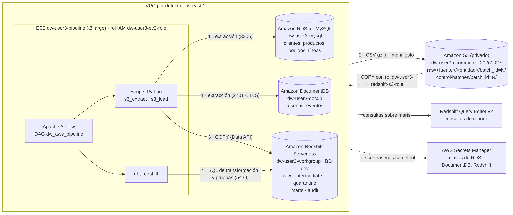
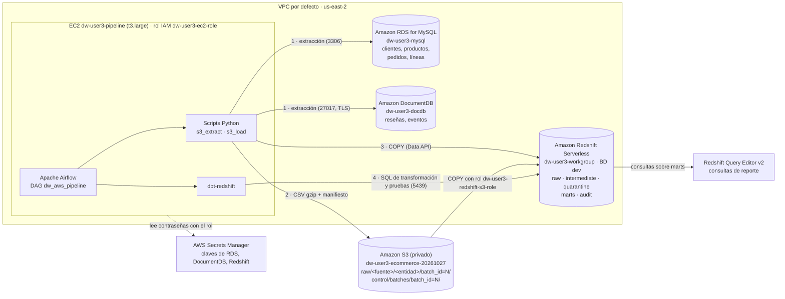

# Arquitectura en AWS

Migré la solución local (MySQL + MongoDB + DuckDB + dbt + Airflow en Docker) a servicios
administrados de AWS en la región **us-east-2 (Ohio)**, conservando las reglas de negocio y el
modelo dimensional del repositorio DE-DW.

## Diagrama

Versión editable (Mermaid):

## Componentes

| Componente | Versión local | Versión AWS | Responsabilidad |
|---|---|---|---|
| Fuente relacional | MySQL 8.4 en Docker | **RDS for MySQL 8.0** (db.t4g.micro, privado, cifrado) | Clientes, productos, pedidos y líneas |
| Fuente documental | MongoDB 8.0 en Docker | **DocumentDB 5.0** (1 × db.t3.medium, privado, cifrado, TLS) | Reseñas y eventos de navegación |
| Zona de aterrizaje | CSV en `warehouse/extracts/` | **S3** privado, versionado, SSE-S3, solo HTTPS | Conserva cada lote para reprocesar sin consultar las fuentes |
| Almacén analítico | DuckDB (archivo) | **Redshift Serverless** (capacidad base mínima, sin acceso público) | Capas raw, intermediate, quarantine, marts y audit |
| Transformaciones | dbt-duckdb | **dbt-redshift** en la EC2 | Calidad, cuarentena, SCD2, hechos incrementales, pruebas |
| Orquestación | Airflow en Docker local | **Airflow en Docker sobre EC2** | DAG `dw_aws_pipeline` de punta a punta |
| Secretos | `.env` local | **Secrets Manager** + rol IAM de la EC2 | Ninguna contraseña en el código ni en archivos de configuración |
| Consumo | DBeaver | **Redshift Query Editor v2** sobre `marts` | Consultas de reporte y validación del indicador |

## Flujo de un lote

1. **Validación**: Airflow comprueba S3, Redshift (Data API), RDS y DocumentDB.
2. **Extracción** (`s3_extract.py`): lee cada entidad y escribe `raw/<fuente>/<entidad>/batch_id=N/<entidad>.csv.gz`
   con las columnas de control `_batch_id`, `_extracted_at`, `_source`. Al final escribe
   `control/batches/batch_id=N/manifest.json` y registra cada archivo en `audit.batch_log` (estado `extracted`).
3. **Carga** (`s3_load.py`): por entidad, en una transacción: borra el lote en `"raw"`, ejecuta `COPY ... IAM_ROLE default`,
   marca `loaded` en `audit.batch_log` y avanza `audit.extraction_watermark`.
4. **dbt**: seed → intermediate (staging + QA + valid) → quarantine → snapshot (SCD2) → marts → test.
5. **Registro**: `audit.pipeline_runs` guarda el estado final (success/failed) y la tarea que falló.

## Red y acceso

| Origen → destino | Puerto | Regla |
|---|---|---|
| EC2 → RDS | 3306 | `dw-user3-sources-sg` solo acepta desde `dw-user3-ec2-sg` |
| EC2 → DocumentDB | 27017 | igual; TLS obligatorio |
| EC2 → Redshift | 5439 | `dw-user3-redshift-sg` solo acepta desde `dw-user3-ec2-sg` |
| Administración → EC2 | 22 | Solo desde la IP de CloudShell (/32), llave temporal de EC2 Instance Connect |
| Navegador → Airflow | 8080 | Cerrado por defecto; se abre solo a una IP (/32) con `airflow_ui_cidr` |
| Redshift → S3 | HTTPS | Rol IAM de solo lectura sobre `raw/*` |

RDS, DocumentDB y Redshift **no tienen acceso público**.
